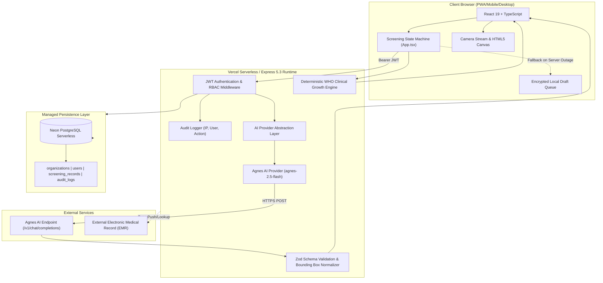

# SYSTEM ARCHITECTURE DOCUMENTATION
**System:** SONRI ORALYTIC AI 2.0  
**Architect:** Principal CTO & Security Architect  
**Version:** 2.0.0-RC1  
**Architecture Style:** Modular Monolith (Client-Side SPA + Serverless Backend + Managed Database)

---

## 1. High-Level System Architecture



---

## 2. Decoupled AI Provider Architecture

The AI layer is abstracted behind the `AIProvider` interface to eliminate vendor lock-in:

```
services/ai/
  ├── provider.ts        # AIProvider interface definition
  ├── agnesProvider.ts   # Agnes AI client (HTTP /v1/chat/completions, retry, backoff)
  ├── schemas.ts         # Zod schemas & coordinate normalizers
  ├── prompts.ts         # Clinical prompt templates (Layer A/B/C separation)
  └── errors.ts          # Custom AIProviderError classification
```

### Multimodal Pipeline
1. Client compresses and validates image (`<= 10MB`, JPEG/PNG/WebP).
2. Client converts photo to Base64 and sends to `/api/ai/check-quality`.
3. Server evaluates image clarity via Agnes AI; if `poor` or `unable_to_assess`, client requires user action.
4. If image passes quality gate, client sends to `/api/ai/analyze-oral`.
5. Agnes AI returns ICD-10 findings and bounding box coordinates.
6. The `normalizeBoundingBox` pipeline clamps coordinates to `[0, 100]` percentage relative to image dimensions.
7. Anthropometric data is calculated deterministically via `stuntingCalculator.ts` (Layer A).
8. Report narrative is synthesized via `/api/ai/final-report` combining verified calculations (Layer A) with observational findings (Layer B) into human-reviewable advice (Layer C).

---

## 3. Database Schema & Multi-Tenancy

Every patient record and user is isolated by `organization_id`.

```sql
organizations (id PK, name, code UNIQUE, created_at)
users (id PK, organization_id FK, name, email UNIQUE, password_hash, role, created_at, updated_at)
screening_records (id PK, organization_id FK, created_by FK, nik, patient_name, dob, gender, screening_date, record_data JSONB, created_at, updated_at)
audit_logs (id PK, user_id, organization_id, action, resource_type, resource_id, details JSONB, ip_address, created_at)
```

### Indexes:
- `idx_screening_org_date`: `(organization_id, screening_date DESC)`
- `idx_screening_nik`: `(organization_id, nik)`
- `idx_users_email`: `(email)`
- `idx_audit_org`: `(organization_id, created_at DESC)`
