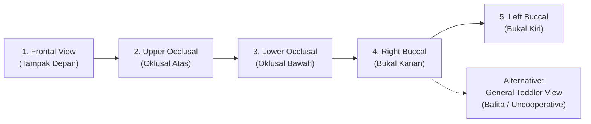

# CLINICAL ORAL PHOTOGRAPHY CAPTURE PROTOCOL
**Sonry Oralytic AI 2.0 — Standard Operating Procedure (SOP)**
**Target Audience:** Community Health Workers (Kader Posyandu), Dental Nurses, Bidan, Pediatric Clinicians  
**Context:** Field Screening, Posyandu, Primary Health Centers (Puskesmas), & Teledentistry

---

## 1. Clinical Rationale: Why Multi-View Capture is Mandatory

Human dentition consists of complex three-dimensional curves across maxilla and mandible. A single frontal photograph captures **less than 20%** of total tooth surfaces and almost completely obscures:
1. Occlusal pits and fissures of primary and permanent molars (where >85% of early childhood caries develop).
2. Lingual and palatal enamel surfaces.
3. Buccal cervical surfaces of posterior molars.

To ensure diagnostic reliability and eliminate false negatives, Sonry Oralytic 2.0 establishes a **standard multi-view capture protocol**.

---

## 2. Standard Multi-View Photographic Series

### 1. Frontal View (`FRONT_VIEW`) — Tampak Depan
- **Anatomical Target:** Labial surfaces of maxillary and mandibular incisors, canines, and anterior marginal gingiva.
- **Patient Position:** Teeth in habitual occlusion (biting together gently) or slightly parted (~2 mm).
- **Clinical Alignment:** Camera lens perpendicular to the facial midline at the level of the occlusal plane.
- **Visual Goal:** Detection of early childhood white spot lesions on upper incisors (`K02.0`), enamel hypoplasia (`K00.4`), anterior crowding (`K07.3`), and marginal gingivitis (`K05.1`).

### 2. Upper Occlusal View (`UPPER_OCCLUSAL`) — Oklusal Rahang Atas
- **Anatomical Target:** Biting (occlusal) surfaces of maxillary primary molars / permanent molars and premolars.
- **Patient Position:** Patient tilts head slightly back; mouth opened wide.
- **Clinical Alignment:** Camera angled ~45° upward towards the palate, or using an intraoral photographic mirror if available.
- **Visual Goal:** Inspection of pit and fissure caries (`K02.1` / `K02.52`), fissure discoloration, and palatal plaque.

### 3. Lower Occlusal View (`LOWER_OCCLUSAL`) — Oklusal Rahang Bawah
- **Anatomical Target:** Biting surfaces of mandibular primary molars / permanent molars and premolars.
- **Patient Position:** Chin tilted down towards the chest; mouth opened wide; tongue relaxed on floor of mouth.
- **Clinical Alignment:** Camera angled ~45° downward looking onto the mandibular arch.
- **Visual Goal:** Detection of mandibular molar caries (highest caries incidence in pediatric cohorts).

### 4. Right Buccal View (`RIGHT_BUCCAL`) — Bukal Kanan
- **Anatomical Target:** Outer (cheek-side) surfaces of right molars, premolars, and canine.
- **Retraction:** Gentle cheek retraction using a clean dental retractor, wooden tongue depressor, or clean finger.
- **Visual Goal:** Class I/II/III molar relationship and cervical buccal smooth surface caries (`K02.61` / `K02.62`).

### 5. Left Buccal View (`LEFT_BUCCAL`) — Bukal Kiri
- **Anatomical Target:** Outer (cheek-side) surfaces of left molars, premolars, and canine.
- **Retraction:** Symmetric cheek retraction on the left quadrant.
- **Visual Goal:** Contralateral caries assessment and gingival health.

### 6. General Field View (`GENERAL_VIEW`) — Alternatif Balita / Posyandu
- **Indication:** Children under 24 months, anxious toddlers, or uncooperative patients where full 5-angle capture is clinically impractical.
- **Protocol:** Single clear wide-mouth photograph capturing as many visible arches as possible in natural light.
- **Informatics Rule:** The AI automatically flags the examination as provisional, requiring clinical abstention on unvisualized quadrants.

---

## 3. Preparation & Field Capture Techniques

### A. Lighting & Exposure
- **Natural Diffuse Light:** Whenever possible, position the child facing a window or under bright ambient white light.
- **Smart Phone Flash:** Use diffused fill-flash (avoid holding flash closer than 15 cm to prevent blown-out specular reflections/glare on moist enamel).
- **Drying Enamel:** If excessive pooling of saliva obscures fissures, have the parent/caregiver gently dab the biting surface with a sterile gauze pad prior to photo capture.

### B. Pediatric Patient Management (Tell-Show-Do)
1. **Explain playfully:** "Kita mau ambil foto gigi cantik pakai kamera handphone ya!"
2. **Demonstrate on toy/parent:** Tap camera button on parent's finger first.
3. **Knee-to-Knee Position (Infants <24 months):** Parent and healthcare worker sit knee-to-knee; child's head rests comfortably in the worker's lap while parent holds hands. Allows direct, safe intraoral visualization without stress.

---

## 4. Automated Image Quality Rejection Criteria

The Sonry Oralytic system implements **automated Stage A quality gating**. Photos with any of the following 7 defects are automatically rejected with actionable guidance:

| Degradation Factor | System Detection Rule | Actionable Feedback in UI |
| :--- | :--- | :--- |
| **Non-Oral Photo** | Image lacks oral mucosa, dental arches, or teeth. | *"Foto bukan merupakan rongga mulut. Harap arahkan kamera ke dalam mulut pasien."* |
| **Teeth Invisible** | Lips closed, tongue completely covering teeth, or edentulous infant. | *"Gigi tidak terlihat. Harap buka mulut pasien lebih lebar atau singkirkan bibir perlahan."* |
| **Severe Motion Blur** | Edge frequency gradient below focus threshold. | *"Foto buram akibat gerakan. Pegang kamera lebih stabil dan minta anak diam sejenak."* |
| **Severe Glare** | Saturated white pixels (>95% brightness) on >20% of tooth surface. | *"Pantulan kilat kamera terlalu silau. Jauhkan kamera sedikit atau gunakan cahaya alami."* |
| **Severe Darkness** | Mean intraoral pixel luminosity <30 (underexposed). | *"Foto terlalu gelap. Harap gunakan lampu penerangan atau senter periksa."* |
| **Heavy Obstruction** | Fingers, tongue depressor, or lips covering >50% of dental arch. | *"Sebagian besar gigi terhalang jari atau lidah. Buka mulut dengan bantuan kapas atau sendok bersih."* |
| **Poor Framing** | Camera too distant (>50 cm) or angled away from occlusal plane. | *"Posisi kamera terlalu jauh. Dekatkan kamera dengan jarak 15–20 cm dari mulut."* |
